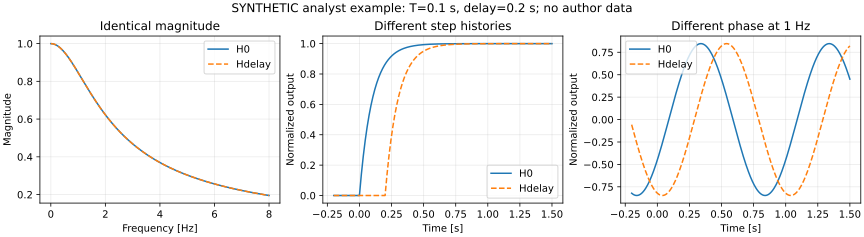

# 阵风尺度、响应指标和可辨识性（2026-10-16）

本次沿既有claim、source record与已完成审计做知识综合，不新增作者测量或重读已达标全文。当前10条待办的原始输出复现仍待输入，但输入、输出与模型识别的接口可以明确。逐条比较见[gust/response matrix](gust_response_comparison.csv)。

## 时间、长度和事件零点要分开

空间过渡长度不是持续时间。**ANALYST_INFERENCE**：仅对静止空间风场、恒定沿程速度V和已知车辆参考点，`s=V(t-t0)`，故同一参考点穿过长度sm的时间为`sm/V`；无量纲`t*=V(t-t0)/l`的过渡宽度为`sm/l`。Hucho Eq23给的是空间半余弦过渡；这不是车辆尾部离开风区的时刻，更不是载荷完全建立的时间。

若风场随时间变化、车速变动或车辆横摆改变参考点运动，必须保留实际路径s(t)和局部相对风，不能套一个L/V。Winkler的模型/整车St时间缩放还涉及不同长度和速度；它不能被一次参考点穿越公式替代。Nakasato的40m/33.3m/s约1.20s只是既有名义一致性检查，完整车身暴露和边沿时长仍需原始风场。

“上升时间”必须说明0–100%、10–90%或作者自己的阈值，且区分入流、局部压力、积分载荷、车辆运动。未知边沿不从试验段宽度自动反推；五车长风区不证明五车长内已达稳态（E-2000-0876-03）。

## 峰值比、平均值、幅值比与功率导纳

- Macklin1996的mean是车尾进入至车头离开风区的完全浸没时段平均，peak是记录最大值（E-1996-03）。不能把它换成逐次试验平均或绝对值最大值。
- Chadwick2000的峰/均比约2.5与1.5绑定不同车形和25°工况（E-2000-0876-01）；它不是Passmore正弦幅值/QS幅值。
- Ryan1998侧力、上表面升力峰值相对各自稳态值约18%、12%，总横摆峰值0.37未超过0.39稳态（E-1998-01/02）。不能概括为“所有载荷都超调”。
- Volpe2014的16%/10%横摆峰值分别相对各自建立值；硬件30°夹角与模型处约21°来流又不同（E-2014-01/02）。不能直接与Ryan30°系数相除或判为相反结果。
- Passmore2001同频正弦倍率`chi_a=A_transient/A_QS`，文中功率导纳为该倍率平方（E-2001-03）。相同的均方/幅值信息不包含完整复数相位。其加入沿车长传播相位的QS基线会改变横摆倍率解释（E-2001-04）。

现有原点/规范化转换见[昨日载荷工具](load_reexpression.md)。即使单位和原点都统一，事件窗口、基线、频率/风形、处理链和环路条件仍必须匹配。

## 一个能直接检查的幅值非唯一性反例

**ANALYST_INFERENCE，全部参数均为合成选择**：考虑两个因果稳定归一化线性系统

`H0(s)=1/(1+T s)`，`Hd(s)=exp(-tau s)/(1+T s)`，其中`T>0,tau>=0`。

因为`|exp(-i omega tau)|=1`，二者在所有频率的幅值与功率完全相同，但相位相差`-omega tau`。阶跃响应一个立即开始、另一个延迟tau后开始。即使知道全部频率的精确幅值，缺少额外相位/时标/模型假设也不能唯一识别这两个候选系统。这里未假定minimum phase，不能用只对更强模型类成立的恢复方法来消掉该反例。

脚本选择T=0.1s、tau=0.2s，仅用于证明非唯一性；它们不是任何论文的气动时间常数。输出7个频率算例和341行合成时程，明确标SYNTHETIC；不是风洞数据、ROM拟合或整车预测。该反例不否定Passmore测得的局部压力相位，也不把其倍率直接当成H0。

## 对现有知识链的直接影响

输入/输出的同步原始时程、源内坐标与参考点、触发及传感器/滤波延迟、全车积分载荷复数幅相、模型假设和独立预测事件仍是建立可验证ROM的重要输入。它们可与已有8项原始资料交付表衔接；本次不制造新的资料请求或声称已取得这些信息。当前方法链能说明如何检查可辨识性，不能把一张倍率曲线直接当作完整状态空间模型或车辆控制载荷表。
