# 初版知识图谱

下图由 `graph/edges.csv` 生成，箭头均在该表保留 `source_id`、条件、核验状态和说明。E1 是公开摘要层级，E2 是已核读原文范围；箭头表示有条件的关系，不是跨车型普适定律。图中证据节点 `E-*` 再指向规范来源，构成知识→主张→来源路径。

当前图谱覆盖已建立证据节点的来源；覆盖数量由 nodes/evidence.csv 与 sources/index.csv 核对，学习完成状态以 state.json 为准。图谱尚未包含完整风→车→驾驶员因果链；断边记录于 `open_questions.md`。

```mermaid
flowchart LR
    N_E_1953_01["E-1953-01"] -->|evidence_from| N_sae_530255["sae-530255"]
    N_E_1979_01["E-1979-01"] -->|evidence_from| N_dot_hs_805_078["dot-hs-805-078"]
    N_E_1996_01["E-1996-01"] -->|evidence_from| N_sae_960674["sae-960674"]
    N_E_1998_01["E-1998-01"] -->|evidence_from| N_sae_980392["sae-980392"]
    N_E_2001_01["E-2001-01"] -->|evidence_from| N_pimeche_2001_passmore["pimeche-2001-passmore"]
    N_E_2010_01["E-2010-01"] -->|evidence_from| N_iso_12021_2010["iso-12021-2010"]
    N_C_GUST["C-GUST"] -->|described_by| N_E_1953_01["E-1953-01"]
    N_C_LOOP["C-LOOP"] -->|described_by| N_E_1979_01["E-1979-01"]
    N_C_QS["C-QS"] -->|described_by| N_E_1996_01["E-1996-01"]
    N_C_OVERSHOOT["C-OVERSHOOT"] -->|described_by| N_E_1998_01["E-1998-01"]
    N_C_DYNLOAD["C-DYNLOAD"] -->|described_by| N_E_2001_01["E-2001-01"]
    N_C_LOOP["C-LOOP"] -->|described_by| N_E_2010_01["E-2010-01"]
    N_G_FINITE["G-FINITE"] -->|generated_by| N_M_FULL["M-FULL"]
    N_G_SINE["G-SINE"] -->|generated_by| N_M_OSC["M-OSC"]
    N_C_QS["C-QS"] -->|depends_on| N_C_STEADY["C-STEADY"]
    N_E_1968_01["E-1968-01"] -->|evidence_from| N_trid_116341["trid-116341"]
    N_C_STEADY_VEH["C-STEADY-VEH"] -->|described_by| N_E_1968_01["E-1968-01"]
    N_E_1971_01["E-1971-01"] -->|evidence_from| N_sae_710287["sae-710287"]
    N_C_VEHMOTION["C-VEHMOTION"] -->|described_by| N_E_1971_01["E-1971-01"]
    N_E_1973_01["E-1973-01"] -->|evidence_from| N_sae_730232["sae-730232"]
    N_C_DYNLOAD["C-DYNLOAD"] -->|described_by| N_E_1973_01["E-1973-01"]
    N_E_1997_01["E-1997-01"] -->|evidence_from| N_sae_970135["sae-970135"]
    N_C_DYNLOAD["C-DYNLOAD"] -->|described_by| N_E_1997_01["E-1997-01"]
    N_E_2000_0874_01["E-2000-0874-01"] -->|evidence_from| N_sae_2000_01_0874["sae-2000-01-0874"]
    N_C_DYNLOAD["C-DYNLOAD"] -->|described_by| N_E_2000_0874_01["E-2000-0874-01"]
    N_E_2000_0876_01["E-2000-0876-01"] -->|evidence_from| N_sae_2000_01_0876["sae-2000-01-0876"]
    N_C_DYNLOAD["C-DYNLOAD"] -->|described_by| N_E_2000_0876_01["E-2000-0876-01"]
    N_E_2016_01["E-2016-01"] -->|evidence_from| N_jcp_2016_tunay["jcp-2016-tunay"]
    N_C_VEHMOTION["C-VEHMOTION"] -->|described_by| N_E_2016_01["E-2016-01"]
    N_E_2017_1515_01["E-2017-1515-01"] -->|evidence_from| N_sae_2017_01_1515["sae-2017-01-1515"]
    N_C_VEHMOTION["C-VEHMOTION"] -->|described_by| N_E_2017_1515_01["E-2017-1515-01"]
    N_E_1980_01["E-1980-01"] -->|evidence_from| N_sae_800848["sae-800848"]
    N_E_1997_CFD_01["E-1997-CFD-01"] -->|evidence_from| N_sae_970404["sae-970404"]
    N_E_2014_01["E-2014-01"] -->|evidence_from| N_jweia_2014_volpe["jweia-2014-volpe"]
    N_E_2017_1525_01["E-2017-1525-01"] -->|evidence_from| N_sae_2017_01_1525["sae-2017-01-1525"]
    N_E_2021_01["E-2021-01"] -->|evidence_from| N_sae_06_14_01_0001["sae-06-14-01-0001"]
    N_E_2023_01["E-2023-01"] -->|evidence_from| N_brandt_2023_thesis["brandt-2023-thesis"]
    N_E_2025_01["E-2025-01"] -->|evidence_from| N_sae_15_18_01_0005["sae-15-18-01-0005"]
    N_C_STEADY_VEH["C-STEADY-VEH"] -->|described_by| N_E_1980_01["E-1980-01"]
    N_C_DYNLOAD["C-DYNLOAD"] -->|described_by| N_E_1997_CFD_01["E-1997-CFD-01"]
    N_C_OVERSHOOT["C-OVERSHOOT"] -->|described_by| N_E_2014_01["E-2014-01"]
    N_C_VEHMOTION["C-VEHMOTION"] -->|described_by| N_E_2017_1525_01["E-2017-1525-01"]
    N_C_PHASE["C-PHASE"] -->|described_by| N_E_2021_01["E-2021-01"]
    N_C_VEHMOTION["C-VEHMOTION"] -->|described_by| N_E_2023_01["E-2023-01"]
    N_C_GUST["C-GUST"] -->|described_by| N_E_2025_01["E-2025-01"]
    N_E_2023_02["E-2023-02"] -->|evidence_from| N_brandt_2023_thesis["brandt-2023-thesis"]
    N_C_QS["C-QS"] -->|described_by| N_E_2023_02["E-2023-02"]
    N_M_QSD["M-QSD"] -->|supported_by| N_E_2023_02["E-2023-02"]
    N_E_2023_03["E-2023-03"] -->|evidence_from| N_brandt_2023_thesis["brandt-2023-thesis"]
    N_M_3DOF["M-3DOF"] -->|supported_by| N_E_2023_03["E-2023-03"]
    N_E_2023_04["E-2023-04"] -->|evidence_from| N_brandt_2023_thesis["brandt-2023-thesis"]
    N_C_LOOP["C-LOOP"] -->|described_by| N_E_2023_04["E-2023-04"]
    N_E_2023_05["E-2023-05"] -->|evidence_from| N_brandt_2023_thesis["brandt-2023-thesis"]
    N_C_VALIDATION["C-VALIDATION"] -->|described_by| N_E_2023_05["E-2023-05"]
    N_E_2001_02["E-2001-02"] -->|evidence_from| N_pimeche_2001_passmore["pimeche-2001-passmore"]
    N_EQ_RED_FREQ["EQ-RED-FREQ"] -->|described_by| N_E_2001_02["E-2001-02"]
    N_E_2001_03["E-2001-03"] -->|evidence_from| N_pimeche_2001_passmore["pimeche-2001-passmore"]
    N_EQ_ADMIT["EQ-ADMIT"] -->|described_by| N_E_2001_03["E-2001-03"]
    N_EQ_MAGNIFICATION["EQ-MAGNIFICATION"] -->|described_by| N_E_2001_03["E-2001-03"]
    N_E_2001_04["E-2001-04"] -->|evidence_from| N_pimeche_2001_passmore["pimeche-2001-passmore"]
    N_C_PHASE["C-PHASE"] -->|described_by| N_E_2001_04["E-2001-04"]
    N_C_QS["C-QS"] -->|described_by| N_E_2001_04["E-2001-04"]
    N_E_2001_05["E-2001-05"] -->|evidence_from| N_pimeche_2001_passmore["pimeche-2001-passmore"]
    N_C_VALIDATION["C-VALIDATION"] -->|described_by| N_E_2001_05["E-2001-05"]
    N_C_DYNLOAD["C-DYNLOAD"] -->|described_by| N_E_2001_05["E-2001-05"]
    N_E_2001_06["E-2001-06"] -->|evidence_from| N_pimeche_2001_passmore["pimeche-2001-passmore"]
    N_M_OSC["M-OSC"] -->|described_by| N_E_2001_06["E-2001-06"]
    N_E_2025_02["E-2025-02"] -->|evidence_from| N_sae_15_18_01_0005["sae-15-18-01-0005"]
    N_C_GUST["C-GUST"] -->|described_by| N_E_2025_02["E-2025-02"]
    N_E_2025_03["E-2025-03"] -->|evidence_from| N_sae_15_18_01_0005["sae-15-18-01-0005"]
    N_C_VALIDATION["C-VALIDATION"] -->|described_by| N_E_2025_03["E-2025-03"]
    N_E_2013_01["E-2013-01"] -->|evidence_from| N_jfe_2013_volpe["jfe-2013-volpe"]
    N_C_VALIDATION["C-VALIDATION"] -->|described_by| N_E_2013_01["E-2013-01"]
    N_E_2025_04["E-2025-04"] -->|evidence_from| N_sae_15_18_01_0005["sae-15-18-01-0005"]
    N_C_VALIDATION["C-VALIDATION"] -->|described_by| N_E_2025_04["E-2025-04"]
    N_E_1967_01["E-1967-01"] -->|evidence_from| N_sae_670608["sae-670608"]
    N_C_OVERSHOOT["C-OVERSHOOT"] -->|described_by| N_E_1967_01["E-1967-01"]
    N_C_QS["C-QS"] -->|described_by| N_E_1967_01["E-1967-01"]
    N_E_1967_02["E-1967-02"] -->|evidence_from| N_sae_670608["sae-670608"]
    N_M_MOVING["M-MOVING"] -->|described_by| N_E_1967_02["E-1967-02"]
    N_C_VALIDATION["C-VALIDATION"] -->|described_by| N_E_1967_02["E-1967-02"]
    N_M_SLENDER["M-SLENDER"] -->|described_by| N_E_1973_01["E-1973-01"]
    N_C_VALIDATION["C-VALIDATION"] -->|described_by| N_E_1973_01["E-1973-01"]
    N_E_1958_01["E-1958-01"] -->|evidence_from| N_bams_1958_benner["bams-1958-benner"]
    N_M_ROAD["M-ROAD"] -->|described_by| N_E_1958_01["E-1958-01"]
    N_E_1958_02["E-1958-02"] -->|evidence_from| N_bams_1958_benner["bams-1958-benner"]
    N_C_LOOP["C-LOOP"] -->|described_by| N_E_1958_02["E-1958-02"]
    N_E_1996_02["E-1996-02"] -->|evidence_from| N_sae_960674["sae-960674"]
    N_C_VALIDATION["C-VALIDATION"] -->|described_by| N_E_1996_02["E-1996-02"]
    N_E_1998_02["E-1998-02"] -->|evidence_from| N_sae_980392["sae-980392"]
    N_C_QS["C-QS"] -->|described_by| N_E_1998_02["E-1998-02"]
    N_E_1998_03["E-1998-03"] -->|evidence_from| N_sae_980392["sae-980392"]
    N_C_VALIDATION["C-VALIDATION"] -->|described_by| N_E_1998_03["E-1998-03"]
    N_E_1973_02["E-1973-02"] -->|evidence_from| N_sae_730232["sae-730232"]
    N_EQ_REICHARDT_MIXING["EQ-REICHARDT-MIXING"] -->|described_by| N_E_1973_02["E-1973-02"]
    N_E_1997_02["E-1997-02"] -->|evidence_from| N_sae_970135["sae-970135"]
    N_C_QS["C-QS"] -->|described_by| N_E_1997_02["E-1997-02"]
    N_E_2000_0874_02["E-2000-0874-02"] -->|evidence_from| N_sae_2000_01_0874["sae-2000-01-0874"]
    N_C_VALIDATION["C-VALIDATION"] -->|described_by| N_E_2000_0874_02["E-2000-0874-02"]
    N_E_2000_0874_03["E-2000-0874-03"] -->|evidence_from| N_sae_2000_01_0874["sae-2000-01-0874"]
    N_C_VALIDATION["C-VALIDATION"] -->|described_by| N_E_2000_0874_03["E-2000-0874-03"]
    N_E_1971_02["E-1971-02"] -->|evidence_from| N_sae_710287["sae-710287"]
    N_C_VEHMOTION["C-VEHMOTION"] -->|described_by| N_E_1971_02["E-1971-02"]
    N_E_1980_02["E-1980-02"] -->|evidence_from| N_sae_800848["sae-800848"]
    N_C_VALIDATION["C-VALIDATION"] -->|described_by| N_E_1980_02["E-1980-02"]
    N_E_1980_03["E-1980-03"] -->|evidence_from| N_sae_800848["sae-800848"]
    N_C_QS["C-QS"] -->|described_by| N_E_1980_03["E-1980-03"]
    N_E_2000_0876_02["E-2000-0876-02"] -->|evidence_from| N_sae_2000_01_0876["sae-2000-01-0876"]
    N_C_VALIDATION["C-VALIDATION"] -->|described_by| N_E_2000_0876_02["E-2000-0876-02"]
    N_E_2000_0876_03["E-2000-0876-03"] -->|evidence_from| N_sae_2000_01_0876["sae-2000-01-0876"]
    N_C_QS["C-QS"] -->|described_by| N_E_2000_0876_03["E-2000-0876-03"]
    N_E_2017_1525_02["E-2017-1525-02"] -->|evidence_from| N_sae_2017_01_1525["sae-2017-01-1525"]
    N_C_VALIDATION["C-VALIDATION"] -->|described_by| N_E_2017_1525_02["E-2017-1525-02"]
    N_E_2017_1525_03["E-2017-1525-03"] -->|evidence_from| N_sae_2017_01_1525["sae-2017-01-1525"]
    N_C_LOOP["C-LOOP"] -->|described_by| N_E_2017_1525_03["E-2017-1525-03"]
    N_E_2014_02["E-2014-02"] -->|evidence_from| N_jweia_2014_volpe["jweia-2014-volpe"]
    N_C_GUST["C-GUST"] -->|described_by| N_E_2014_02["E-2014-02"]
    N_E_2014_03["E-2014-03"] -->|evidence_from| N_jweia_2014_volpe["jweia-2014-volpe"]
    N_C_DYNLOAD["C-DYNLOAD"] -->|described_by| N_E_2014_03["E-2014-03"]
    N_E_2017_1515_02["E-2017-1515-02"] -->|evidence_from| N_sae_2017_01_1515["sae-2017-01-1515"]
    N_C_VALIDATION["C-VALIDATION"] -->|described_by| N_E_2017_1515_02["E-2017-1515-02"]
    N_E_2017_1515_03["E-2017-1515-03"] -->|evidence_from| N_sae_2017_01_1515["sae-2017-01-1515"]
    N_C_QS["C-QS"] -->|described_by| N_E_2017_1515_03["E-2017-1515-03"]
    N_E_1997_CFD_02["E-1997-CFD-02"] -->|evidence_from| N_sae_970404["sae-970404"]
    N_C_VALIDATION["C-VALIDATION"] -->|described_by| N_E_1997_CFD_02["E-1997-CFD-02"]
    N_E_1997_CFD_03["E-1997-CFD-03"] -->|evidence_from| N_sae_970404["sae-970404"]
    N_C_VALIDATION["C-VALIDATION"] -->|described_by| N_E_1997_CFD_03["E-1997-CFD-03"]
    N_E_1973_03["E-1973-03"] -->|evidence_from| N_sae_730232["sae-730232"]
    N_EQ_HUCHO_CLEARANCE["EQ-HUCHO-CLEARANCE"] -->|described_by| N_E_1973_03["E-1973-03"]
    N_M_SLENDER["M-SLENDER"] -->|described_by| N_E_1973_03["E-1973-03"]
    N_E_1973_04["E-1973-04"] -->|evidence_from| N_sae_730232["sae-730232"]
    N_EQ_YAW["EQ-YAW"] -->|described_by| N_E_1973_04["E-1973-04"]
    N_V_YAWMOMENT["V-YAWMOMENT"] -->|described_by| N_E_1973_04["E-1973-04"]
    N_V_HEADING["V-HEADING"] -->|described_by| N_E_1973_04["E-1973-04"]
    N_V_BETA_AERO["V-BETA-AERO"] -->|described_by| N_E_1973_04["E-1973-04"]
    N_E_1967_03["E-1967-03"] -->|evidence_from| N_sae_670608["sae-670608"]
    N_EQ_BEAUVAIS_BALANCE["EQ-BEAUVAIS-BALANCE"] -->|described_by| N_E_1967_03["E-1967-03"]
    N_V_YAWMOMENT["V-YAWMOMENT"] -->|described_by| N_E_1967_03["E-1967-03"]
    N_M_MOVING["M-MOVING"] -->|described_by| N_E_1967_03["E-1967-03"]
    N_E_1967_04["E-1967-04"] -->|evidence_from| N_sae_670608["sae-670608"]
    N_EQ_RELWIND["EQ-RELWIND"] -->|described_by| N_E_1967_04["E-1967-04"]
    N_V_BETA_AERO["V-BETA-AERO"] -->|described_by| N_E_1967_04["E-1967-04"]
    N_M_MOVING["M-MOVING"] -->|described_by| N_E_1967_04["E-1967-04"]
```

`evidence_from` 表示原始来源支撑该 atomic claim；`described_by` 表示概念受到特定条件下主张说明；`generated_by` 表示该输入由文献中的方法实现；`depends_on` 表示当前准稳态比较以稳态基线为参照。`supported_by` 表示方法受到特定原文证据支持，与 supports 的反向阅读对应；不表示独立跨方法验证。这些关系不能自动推成 `causes` 或跨研究 `validated_by`。
