# 鍒濈増鐭ヨ瘑鍥捐氨

涓嬪浘鐢?`graph/edges.csv` 鐢熸垚锛岀澶村潎鍦ㄨ琛ㄤ繚鐣?`source_id`銆佹潯浠躲€佹牳楠岀姸鎬佸拰璇存槑銆侲1 鏄叕寮€鎽樿灞傜骇锛孍2 鏄凡鏍歌鍘熸枃鑼冨洿锛涚澶磋〃绀烘湁鏉′欢鐨勫叧绯伙紝涓嶆槸璺ㄨ溅鍨嬫櫘閫傚畾寰嬨€傚浘涓瘉鎹妭鐐?`E-*` 鍐嶆寚鍚戣鑼冩潵婧愶紝鏋勬垚鐭ヨ瘑鈫掍富寮犫啋鏉ユ簮璺緞銆?

褰撳墠鍥捐氨瑕嗙洊宸插缓绔嬭瘉鎹妭鐐圭殑鏉ユ簮锛涜鐩栨暟閲忕敱 nodes/evidence.csv 涓?sources/index.csv 鏍稿锛屽涔犲畬鎴愮姸鎬佷互 state.json 涓哄噯銆傚浘璋卞皻鏈寘鍚畬鏁撮鈫掕溅鈫掗┚椹跺憳鍥犳灉閾撅紱鏂竟璁板綍浜?`open_questions.md`銆?

```mermaid
flowchart LR
    N_E_1953_01["E-1953-01"] -->|evidence_from| N_sae_530255["sae-530255"]
    N_E_1979_01["E-1979-01"] -->|evidence_from| N_dot_hs_805_078["dot-hs-805-078"]
    N_E_1996_01["E-1996-01"] -->|evidence_from| N_sae_960674["sae-960674"]
    N_E_1998_01["E-1998-01"] -->|evidence_from| N_sae_980392["sae-980392"]
    N_E_2001_01["E-2001-01"] -->|evidence_from| N_pimeche_2001_passmore["pimeche-2001-passmore"]
    N_E_2010_01["E-2010-01"] -->|evidence_from| N_iso_12021_2010["iso-12021-2010"]
    N_C_GUST["C-GUST"] -->|described_by| N_E_1953_01["E-1953-01"]
    N_C_LOOP["C-LOOP"] -->|described_by| N_E_1979_01["E-1979-01"]
    N_C_QS["C-QS"] -->|described_by| N_E_1996_01["E-1996-01"]
    N_C_OVERSHOOT["C-OVERSHOOT"] -->|described_by| N_E_1998_01["E-1998-01"]
    N_C_DYNLOAD["C-DYNLOAD"] -->|described_by| N_E_2001_01["E-2001-01"]
    N_C_LOOP["C-LOOP"] -->|described_by| N_E_2010_01["E-2010-01"]
    N_G_FINITE["G-FINITE"] -->|generated_by| N_M_FULL["M-FULL"]
    N_G_SINE["G-SINE"] -->|generated_by| N_M_OSC["M-OSC"]
    N_C_QS["C-QS"] -->|depends_on| N_C_STEADY["C-STEADY"]
    N_E_1968_01["E-1968-01"] -->|evidence_from| N_trid_116341["trid-116341"]
    N_C_STEADY_VEH["C-STEADY-VEH"] -->|described_by| N_E_1968_01["E-1968-01"]
    N_E_1971_01["E-1971-01"] -->|evidence_from| N_sae_710287["sae-710287"]
    N_C_VEHMOTION["C-VEHMOTION"] -->|described_by| N_E_1971_01["E-1971-01"]
    N_E_1973_01["E-1973-01"] -->|evidence_from| N_sae_730232["sae-730232"]
    N_C_DYNLOAD["C-DYNLOAD"] -->|described_by| N_E_1973_01["E-1973-01"]
    N_E_1997_01["E-1997-01"] -->|evidence_from| N_sae_970135["sae-970135"]
    N_C_DYNLOAD["C-DYNLOAD"] -->|described_by| N_E_1997_01["E-1997-01"]
    N_E_2000_0874_01["E-2000-0874-01"] -->|evidence_from| N_sae_2000_01_0874["sae-2000-01-0874"]
    N_C_DYNLOAD["C-DYNLOAD"] -->|described_by| N_E_2000_0874_01["E-2000-0874-01"]
    N_E_2000_0876_01["E-2000-0876-01"] -->|evidence_from| N_sae_2000_01_0876["sae-2000-01-0876"]
    N_C_DYNLOAD["C-DYNLOAD"] -->|described_by| N_E_2000_0876_01["E-2000-0876-01"]
    N_E_2016_01["E-2016-01"] -->|evidence_from| N_jcp_2016_tunay["jcp-2016-tunay"]
    N_C_VEHMOTION["C-VEHMOTION"] -->|described_by| N_E_2016_01["E-2016-01"]
    N_E_2017_1515_01["E-2017-1515-01"] -->|evidence_from| N_sae_2017_01_1515["sae-2017-01-1515"]
    N_C_VEHMOTION["C-VEHMOTION"] -->|described_by| N_E_2017_1515_01["E-2017-1515-01"]
    N_E_1980_01["E-1980-01"] -->|evidence_from| N_sae_800848["sae-800848"]
    N_E_1997_CFD_01["E-1997-CFD-01"] -->|evidence_from| N_sae_970404["sae-970404"]
    N_E_2014_01["E-2014-01"] -->|evidence_from| N_jweia_2014_volpe["jweia-2014-volpe"]
    N_E_2017_1525_01["E-2017-1525-01"] -->|evidence_from| N_sae_2017_01_1525["sae-2017-01-1525"]
    N_E_2021_01["E-2021-01"] -->|evidence_from| N_sae_06_14_01_0001["sae-06-14-01-0001"]
    N_E_2023_01["E-2023-01"] -->|evidence_from| N_brandt_2023_thesis["brandt-2023-thesis"]
    N_E_2025_01["E-2025-01"] -->|evidence_from| N_sae_15_18_01_0005["sae-15-18-01-0005"]
    N_C_STEADY_VEH["C-STEADY-VEH"] -->|described_by| N_E_1980_01["E-1980-01"]
    N_C_DYNLOAD["C-DYNLOAD"] -->|described_by| N_E_1997_CFD_01["E-1997-CFD-01"]
    N_C_OVERSHOOT["C-OVERSHOOT"] -->|described_by| N_E_2014_01["E-2014-01"]
    N_C_VEHMOTION["C-VEHMOTION"] -->|described_by| N_E_2017_1525_01["E-2017-1525-01"]
    N_C_PHASE["C-PHASE"] -->|described_by| N_E_2021_01["E-2021-01"]
    N_C_VEHMOTION["C-VEHMOTION"] -->|described_by| N_E_2023_01["E-2023-01"]
    N_C_GUST["C-GUST"] -->|described_by| N_E_2025_01["E-2025-01"]
    N_E_2023_02["E-2023-02"] -->|evidence_from| N_brandt_2023_thesis["brandt-2023-thesis"]
    N_C_QS["C-QS"] -->|described_by| N_E_2023_02["E-2023-02"]
    N_M_QSD["M-QSD"] -->|supported_by| N_E_2023_02["E-2023-02"]
    N_E_2023_03["E-2023-03"] -->|evidence_from| N_brandt_2023_thesis["brandt-2023-thesis"]
    N_M_3DOF["M-3DOF"] -->|supported_by| N_E_2023_03["E-2023-03"]
    N_E_2023_04["E-2023-04"] -->|evidence_from| N_brandt_2023_thesis["brandt-2023-thesis"]
    N_C_LOOP["C-LOOP"] -->|described_by| N_E_2023_04["E-2023-04"]
    N_E_2023_05["E-2023-05"] -->|evidence_from| N_brandt_2023_thesis["brandt-2023-thesis"]
    N_C_VALIDATION["C-VALIDATION"] -->|described_by| N_E_2023_05["E-2023-05"]
    N_E_2001_02["E-2001-02"] -->|evidence_from| N_pimeche_2001_passmore["pimeche-2001-passmore"]
    N_EQ_RED_FREQ["EQ-RED-FREQ"] -->|described_by| N_E_2001_02["E-2001-02"]
    N_E_2001_03["E-2001-03"] -->|evidence_from| N_pimeche_2001_passmore["pimeche-2001-passmore"]
    N_EQ_ADMIT["EQ-ADMIT"] -->|described_by| N_E_2001_03["E-2001-03"]
    N_EQ_MAGNIFICATION["EQ-MAGNIFICATION"] -->|described_by| N_E_2001_03["E-2001-03"]
    N_E_2001_04["E-2001-04"] -->|evidence_from| N_pimeche_2001_passmore["pimeche-2001-passmore"]
    N_C_PHASE["C-PHASE"] -->|described_by| N_E_2001_04["E-2001-04"]
    N_C_QS["C-QS"] -->|described_by| N_E_2001_04["E-2001-04"]
    N_E_2001_05["E-2001-05"] -->|evidence_from| N_pimeche_2001_passmore["pimeche-2001-passmore"]
    N_C_VALIDATION["C-VALIDATION"] -->|described_by| N_E_2001_05["E-2001-05"]
    N_C_DYNLOAD["C-DYNLOAD"] -->|described_by| N_E_2001_05["E-2001-05"]
    N_E_2001_06["E-2001-06"] -->|evidence_from| N_pimeche_2001_passmore["pimeche-2001-passmore"]
    N_M_OSC["M-OSC"] -->|described_by| N_E_2001_06["E-2001-06"]
    N_E_2025_02["E-2025-02"] -->|evidence_from| N_sae_15_18_01_0005["sae-15-18-01-0005"]
    N_C_GUST["C-GUST"] -->|described_by| N_E_2025_02["E-2025-02"]
    N_E_2025_03["E-2025-03"] -->|evidence_from| N_sae_15_18_01_0005["sae-15-18-01-0005"]
    N_C_VALIDATION["C-VALIDATION"] -->|described_by| N_E_2025_03["E-2025-03"]
    N_E_2013_01["E-2013-01"] -->|evidence_from| N_jfe_2013_volpe["jfe-2013-volpe"]
    N_C_VALIDATION["C-VALIDATION"] -->|described_by| N_E_2013_01["E-2013-01"]
    N_E_2025_04["E-2025-04"] -->|evidence_from| N_sae_15_18_01_0005["sae-15-18-01-0005"]
    N_C_VALIDATION["C-VALIDATION"] -->|described_by| N_E_2025_04["E-2025-04"]
    N_E_1967_01["E-1967-01"] -->|evidence_from| N_sae_670608["sae-670608"]
    N_C_OVERSHOOT["C-OVERSHOOT"] -->|described_by| N_E_1967_01["E-1967-01"]
    N_C_QS["C-QS"] -->|described_by| N_E_1967_01["E-1967-01"]
    N_E_1967_02["E-1967-02"] -->|evidence_from| N_sae_670608["sae-670608"]
    N_M_MOVING["M-MOVING"] -->|described_by| N_E_1967_02["E-1967-02"]
    N_C_VALIDATION["C-VALIDATION"] -->|described_by| N_E_1967_02["E-1967-02"]
    N_M_SLENDER["M-SLENDER"] -->|described_by| N_E_1973_01["E-1973-01"]
    N_C_VALIDATION["C-VALIDATION"] -->|described_by| N_E_1973_01["E-1973-01"]
    N_E_1958_01["E-1958-01"] -->|evidence_from| N_bams_1958_benner["bams-1958-benner"]
    N_M_ROAD["M-ROAD"] -->|described_by| N_E_1958_01["E-1958-01"]
    N_E_1958_02["E-1958-02"] -->|evidence_from| N_bams_1958_benner["bams-1958-benner"]
    N_C_LOOP["C-LOOP"] -->|described_by| N_E_1958_02["E-1958-02"]
```

`evidence_from` 琛ㄧず鍘熷鏉ユ簮鏀拺璇?atomic claim锛沗described_by` 琛ㄧず姒傚康鍙楀埌鐗瑰畾鏉′欢涓嬩富寮犺鏄庯紱`generated_by` 琛ㄧず璇ヨ緭鍏ョ敱鏂囩尞涓殑鏂规硶瀹炵幇锛沗depends_on` 琛ㄧず褰撳墠鍑嗙ǔ鎬佹瘮杈冧互绋虫€佸熀绾夸负鍙傜収銆俙supported_by` 琛ㄧず鏂规硶鍙楀埌鐗瑰畾鍘熸枃璇佹嵁鏀寔锛屼笌 supports 鐨勫弽鍚戦槄璇诲搴旓紱涓嶈〃绀虹嫭绔嬭法鏂规硶楠岃瘉銆傝繖浜涘叧绯讳笉鑳借嚜鍔ㄦ帹鎴?`causes` 鎴栬法鐮旂┒ `validated_by`銆?
